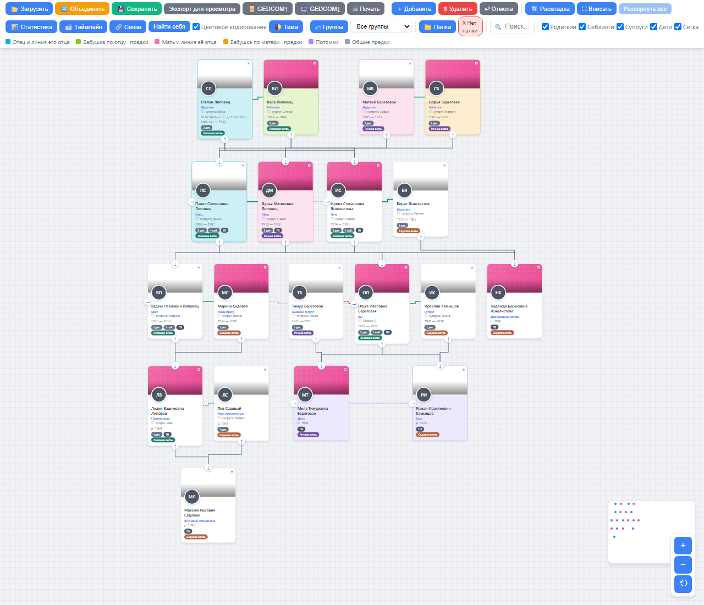

# Family Tree Studio

**Локальная студия семейного дерева.** Собирайте истории, документы и связи в одном редакторе. Когда дерево готово к просмотру, создайте отдельный HTML или PDF, который можно передать родственникам.

## Быстрый старт

1. Скачайте ZIP репозитория через **Code → Download ZIP** и распакуйте его.
2. Откройте [Family Tree Studio](app/family_tree_web_app.html) из распакованной папки в Chrome или Edge.
3. Нажмите **«Загрузить»** и выберите [демо-дерево](demo/tree.json). В нём 19 вымышленных людей, пять поколений и три семейные ветви.
4. Для знакомства со связями выберите карточку через **«Найти себя»**, включите цветовое кодирование и откройте персональную страницу двойным щелчком.

Редактор работает без сервера. Браузер хранит текущую сессию локально. Кнопка **«Сохранить»** скачивает JSON с данными и координатами карточек.

## Возможности студии

| Раздел | Что можно сделать |
| --- | --- |
| **Схема дерева** | Перемещать карточки с выравниванием, менять масштаб, вписывать дерево целиком, сворачивать ветви. Родственные линии следуют за карточками. |
| **Профили** | Заполнять ФИО, биографию, места и даты, добавлять фотографии и видео. Для обложки и аватара можно сохранить отдельное кадрирование. |
| **Родство** | Записывать родителей, братьев и сестёр, детей и несколько союзов. У каждого союза есть свои дети, дата заключения и отдельная дата развода. |
| **Исторические даты** | Указывать неполную или приблизительную дату, диапазон и календарный стиль. Для календарных записей редактор показывает старый и новый стиль. |
| **Поиск и группы** | Находить людей, фильтровать состав групп, просматривать таймлайн. Функция «Найти себя» подписывает родство с выбранным человеком и окрашивает ветви. |
| **Обмен данными** | Загружать, объединять и сохранять JSON, импортировать и экспортировать GEDCOM. |
| **Публикация** | Создавать HTML и PDF для просмотра с персональными страницами без инструментов редактирования. |

Чтобы редактор мог читать локальные фото и видео, нажмите **«Папка»** и выберите рабочий каталог. Медиа хранятся отдельно от JSON, в папках `media/<ID>`. Для переноса проекта сохраните JSON и его папку медиа.

## Публикация для родственников

В меню **«Экспорт для просмотра»** выберите формат. Можно включить или исключить фотографии и биографии.

- **HTML.** Один файл со схемой, масштабом, поиском и связями между персональными страницами. Доступные локальные фотографии встраиваются в файл.
- **PDF.** Схема разбивается на секторы. Алфавитный указатель и карточки на схеме ведут к страницам людей. После подготовки выберите **«Сохранить как PDF»** в окне печати браузера.

В публикацию попадают все карточки и их текущие позиции. Видео, внешние фотографии, поле телефона и поле места проживания исключаются. Проверьте текст биографий перед отправкой.

## Помощник и MCP

Для этой части нужен **Node.js 22+**. Коннектор обнаруживает локальные серверы LM Studio и Unsloth и работает с моделями, которые поддерживают вызов инструментов.

- С помощью локального чата можно задать вопрос о человеке, проследить цепочку родства или подготовить изменение.
- Перед записью чат показывает старые и новые значения. После подтверждения коннектор создаёт резервную копию и сохраняет рабочий JSON.
- Агенты подключаются через MCP по `stdio` или через HTTP API на loopback. Для исследования и внесения правок предусмотрены отдельные скиллы.

На Windows запустите `Start-Family-Assistant.cmd`. В консоли появятся адрес и токен. Настройки моделей, MCP и рабочей копии описаны в [руководстве помощника](docs/assistant.md).

## Файлы репозитория

| Каталог | Содержание |
| --- | --- |
| `app/` | Браузерный редактор и генератор публикаций |
| `demo/` | Вымышленное дерево и иллюстрация интерфейса |
| `mcp/` | Коннектор, HTTP API и локальный чат |
| `skills/` | Инструкции для агентов |
| `tools/` | Генератор демо и тесты |

Демо воспроизводится командой `npm run demo`. Команда `npm test` запускает проверки данных, экспорта и MCP. Для `npm run test:layout` нужен Edge или путь к Chromium в переменной `FAMILY_TEST_BROWSER`.

## Версия

**v1.0.0** · [История версий](CHANGELOG.md)
